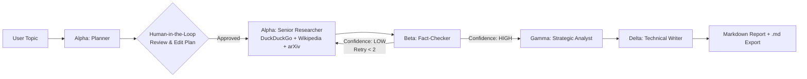

# Multi-Agent Research Assistant

An autonomous, full-stack multi-agent AI research platform powered by **LangGraph**, **FastAPI**, **React**, and **Groq**. It orchestrates four specialized AI agents with a **Human-in-the-Loop (HITL)** approval checkpoint, real-time Server-Sent Events (SSE) telemetry, and live multi-source data retrieval across **DuckDuckGo**, **Wikipedia**, and **arXiv**.

- **Live Dashboard: https://agents-researcher.vercel.app/

---

## Architecture & Workflow

The research pipeline is modeled as a stateful directed graph in **LangGraph** backed by `MemorySaver` checkpointing:



### Agent Roles

1. **Alpha (Planner & Senior Researcher):** Drafts a 4-point research plan for human review, then executes live queries across DuckDuckGo Web Search, Wikipedia, and arXiv preprints to extract concrete facts, metrics, and URLs.
2. **Beta (Fact-Checker):** Audits claims across independent sources for consistency, flags contradictions, and assigns a `HIGH` or `LOW` confidence score (triggering an automated research retry loop if confidence is `LOW`).
3. **Gamma (Strategic Analyst):** Synthesizes verified evidence into core trends, comparative trade-offs, and strategic takeaways.
4. **Delta (Technical Writer):** Compiles a structured, publication-ready Markdown report with inline citations and a complete References list.

---

## Key Features

- **Human-in-the-Loop (HITL) Checkpointing:** Uses LangGraph's `interrupt_before=["researcher"]` and `MemorySaver` thread persistence so users can inspect, edit, or refine the proposed research angles before external searches execute.
- **Real-Time SSE Streaming:** Streams node transitions, agent statuses, and live execution logs from FastAPI (`StreamingResponse`) directly to the React dashboard.
- **Self-Correcting Verification Loop:** Conditional graph routing automatically loops back to the Researcher node when the Fact-Checker flags low confidence.
- **Rate-Limit Resilient Inference:** Engineered with bounded context windows, rolling TPM pacing, and automatic exponential backoff retries to run reliably on Groq's free tier (`groq/openai/gpt-oss-20b`).
- **Report Persistence & Export:** Saves recent research sessions in `localStorage` and supports one-click `.md` file downloads.

---

## Tech Stack

| Layer | Technologies |
|---|---|
| **Frontend** | React, Vite, Lucide Icons, `react-markdown`, Custom CSS |
| **Backend** | Python 3.11, FastAPI, Uvicorn, Pydantic |
| **Agent Orchestration** | LangGraph (`StateGraph`, `MemorySaver`), LangChain Groq |
| **Search & Retrieval** | `duckduckgo-search`, `wikipedia`, `arxiv` |
| **Deployment** | Docker & Render (Backend), Vercel (Frontend) |

---

## Project Structure

```text
multi-agent-researcher/
├── backend/
│   ├── agents/
│   │   └── custom_agents.py      # Agent definitions & Groq LLM configuration
│   ├── graph/
│   │   └── workflow.py           # LangGraph state machine, HITL interrupt & TPM retry logic
│   ├── tools/
│   │   └── search_tools.py       # DuckDuckGo, Wikipedia & arXiv search wrappers
│   ├── Dockerfile                # Production container for Render
│   ├── main.py                   # FastAPI app & SSE streaming endpoints
│   └── requirements.txt          # Pinned Python dependencies
├── frontend/
│   ├── src/
│   │   ├── App.jsx               # Interactive dashboard, SSE reader & HITL review UI
│   │   └── App.css               # Responsive dark-mode glassmorphism styling
│   ├── vercel.json               # SPA routing configuration
│   └── package.json
└── .gitignore
```

---

## Local Setup & Installation

### 1. Clone the Repository

```bash
git clone https://github.com/hexdeploy/multi-agent-researcher.git
cd multi-agent-researcher
```

### 2. Backend Setup

```bash
cd backend
python -m venv venv

# Windows
venv\Scripts\activate
# macOS / Linux
source venv/bin/activate

pip install -r requirements.txt
```

Create a `backend/.env` file:

```env
GROQ_API_KEY=your_groq_api_key_here
GROQ_MODEL_NAME=groq/openai/gpt-oss-20b
```

Start the FastAPI server:

```bash
uvicorn main:app --reload --port 8000
```

### 3. Frontend Setup

Open a second terminal in `frontend/`:

```bash
cd frontend
npm install
npm run dev
```

Open `http://localhost:5173` in your browser. *(Note: When running on the free-tier Render deployment, allow ~30–50 seconds for initial container wake-up if the backend has been idle.)*

---

## API Endpoints

| Method | Endpoint | Description |
|---|---|---|
| `GET` | `/` | Health check returning service status and active LLM model |
| `POST` | `/api/stream-research` | Starts a research graph thread and streams SSE events up to the HITL pause |
| `POST` | `/api/resume-research` | Resumes a paused `thread_id` with the user-approved research plan |
